  

# 🚀 Awesome Interactive Customer Engagement

### *Top Interactive Customer Engagement Ecosystem & Directory* 🌟
**Curated List of SaaS Platforms & Open-Source Projects for Omnichannel Messaging, Live Chat, Push Notifications & Lifecycle Journeys** 💬⚡  
*Last updated: November 2026*

---

## 📌 Introduction & Scope

Welcome to the definitive repository for **Interactive Customer Engagement (ICE)** platforms! 🎯 This curated index tracks market-leading **SaaS solutions** alongside robust **open-source repositories** designed for real-time customer communication, behavioral triggers, onboarding tours, conversational AI, and cross-channel retention.

Whether you are an enterprise growth engineer, product manager, customer success lead, or developer constructing a privacy-first engagement architecture, this ecosystem guide provides comprehensive intelligence across live chat, mobile/web push, email marketing, SMS, WhatsApp, and journey orchestration. 🛠️✨

---

## 📑 Table of Contents

- [📊 Sector Overview & Market Dynamics](#-sector-overview--market-dynamics)
- [🏢 SaaS/Hosted Platforms](#-saashosted-platforms)
- [💻 Open-Source GitHub Projects](#-open-source-github-projects)
- [🧰 Custom Engagement Stack Recipes](#-custom-engagement-stack-recipes)
- [🤝 How to Contribute](#-how-to-contribute)
- [💖 Support & Sponsorship](#-support--sponsorship)
- [📈 Star History](#-star-history)
- [⚖️ Disclaimer](#-disclaimer)

---

## 📊 Sector Overview & Market Dynamics

The global **Customer Engagement Platform (CEP)** and automated customer communication market is valued at approximately **$16.8 billion to $22.5 billion**, rapidly accelerating toward **$48+ billion** over the next decade at a compound annual growth rate (**CAGR**) of **10.2% – 12.3%** driven by real-time conversational AI, first-party customer data activation, and cross-channel messaging automation. 📈🚀

The sector demonstrates a **moderately fragmented** structure: while established enterprise incumbents (such as Salesforce, Adobe, Braze, Klaviyo, and Zoho) capture foundational market share, it is definitively *not* a pure winner-take-all landscape. A dynamic, expanding long-tail of specialized AI-first chat agents, developer-centric notification APIs, privacy-focused self-hosted stacks, and niche retention engines actively command vital segments of the market. 🌐💡

---

## 🏢 SaaS/Hosted Platforms

The table below catalogs premier commercial customer engagement platforms, sorted descending by **company scale (valuation / annual revenue)**:

| 🏷️ Platform | 📝 Description | 💰 Scale (Valuation / Revenue) | 💳 Pricing (Starting Tier) | 🎁 Free Tier / Free Trial Limits |
| :--- | :--- | :--- | :--- | :--- |
| **[Zoho Interactive (Zoho SalesIQ)](https://zoho.com)** | Real-time customer engagement and live chat platform featuring visitor tracking, no-code AI chatbots, and deep CRM integration. | **~$12B+ Valuation** (~$1.5B annual revenue) | $7/operator/month (billed annually) or $10/operator/month (billed monthly) for Basic plan | Free forever for 3 operators, 10,000 tracked visitors/month, 100 chat sessions/month, and 1 brand |
| **[Klaviyo](https://klaviyo.com)** | Intelligent marketing automation platform focused on e-commerce customer data, segmentation, and personalized email and SMS campaigns. | **~$6.0B Market Cap** (NYSE: KVYO) | $20/month for up to 500 active profiles & 5,000 emails/month | Free forever for up to 250 active profiles, 500 email sends/month, and 150 SMS credits (direct email support limited to first 60 days) |
| **[Braze](https://braze.com)** | Enterprise customer engagement platform orchestrating cross-channel messaging across push notifications, in-app messages, email, SMS, and WhatsApp. | **~$5.3B Market Cap** (NASDAQ: BRZE; ~$5.66B EV) | Custom annual contracts starting at ~$2,500/month (~$30,000/year) based on MAU | 14-day free trial in sandbox mode with pre-built journey templates (no permanent free tier) |
| **[Intercom](https://intercom.com)** | AI-first customer service and engagement platform combining live chat, Fin AI agents, product tours, and targeted outbound messaging. | **~$3.0B+ Valuation** (~$400M ARR) | $29/seat/month (billed annually) for Essential plan; $0.99 per Fin AI resolution | 14-day free trial; full feature access (no permanent free tier) |
| **[Iterable](https://iterable.com)** | AI-powered cross-channel customer communication platform built for dynamic journey orchestration, experimentation, and individualized messaging. | **~$2.0B Valuation** (Unicorn status) | Custom annual contracts starting at ~$26,000/year (~$2,166/month) based on MAUs | No free tier; demo and guided sales evaluation only (0-day self-serve trial) |
| **[Drift (Salesloft)](https://salesloft.com)** | Conversational marketing and buyer engagement platform connecting high-intent website visitors with AI chatbots and live sales teams. | **~$1.0B+ Valuation** (Acquired / Merged with Salesloft) | $2,500/month (~$30,000/year billed annually) for Premium conversational marketing tier | No free tier; sales demo only (0-day self-serve trial) |
| **[MoEngage](https://moengage.com)** | Insights-led customer engagement platform featuring AI-driven journey orchestration, mobile push, web personalization, and lifecycle analytics. | **~$900M Valuation** (~$100M+ ARR) | Custom annual contracts starting at ~$1,000/month (~$12,000/year minimum commitment) based on MTUs | No free tier; custom demo and guided proof-of-concept only (0-day self-serve trial) |
| **[CleverTap](https://clevertap.com)** | All-in-one customer retention and engagement suite combining real-time behavioral analytics with omnichannel campaign execution. | **~$775M Valuation** (Series D) | $85/month for Core plan (includes up to 5,000 MAUs & omnichannel engagement) | 30-day free trial for applications under 100,000 MAUs (no permanent free tier) |
| **[Customer.io](https://customer.io)** | Data-driven automated messaging platform allowing product and marketing teams to send behavior-triggered emails, push notifications, and in-app messages. | **~$700M Valuation** (~$100M+ ARR) | $100/month (Essentials tier: includes up to 5,000 profiles & 1M emails/month) | 14-day free trial capped at 50 test emails/day (no permanent free tier; 12 months free for eligible early-stage startups) |
| **[OneSignal](https://onesignal.com)** | Market-leading customer messaging solution specializing in mobile and web push notifications, in-app messaging, email, and SMS. | **~$300M Valuation** (Series C) | $19/month for Growth plan (scales with subscriber volume and unlocks higher MAU limits) | Free forever for up to 1,000 Mobile Push / In-App MAU, 10,000 Web Push subscribers/send, 10,000 emails/month, and 3 journeys |

---

## 💻 Open-Source GitHub Projects

An expanded, verified catalog of active open-source repositories for self-hosting customer engagement pipelines, sorted descending by **GitHub Star Count**:

- **[Twenty](https://github.com/twentyhq/twenty)**   
  The modern, open-source alternative to Salesforce, built for AI, custom objects, and collaborative customer lifecycle workflows.

- **[Rocket.Chat](https://github.com/RocketChat/Rocket.Chat)**   
  High-security, open-source communication platform supporting real-time customer live chat, omnichannel ticketing, voice, video, and federated team engagement.

- **[PostHog](https://github.com/PostHog/posthog)**   
  All-in-one developer platform and customer engagement engine featuring behavioral product analytics, session replay, in-app surveys, feature flags, and event-triggered webhooks.

- **[Novu](https://github.com/novuhq/novu)**   
  Open-source notification and messaging infrastructure enabling developers to orchestrate multi-channel user communication (in-app feed, mobile push, email, SMS, and chat) with a unified API.

- **[Chatwoot](https://github.com/chatwoot/chatwoot)**   
  Leading open-source omnichannel customer support and live chat suite (Intercom & Zendesk alternative) integrating WhatsApp, Instagram, Telegram, email, and conversational AI bots.

- **[ntfy](https://github.com/binwiederhier/ntfy)**   
  Lightweight HTTP-based pub-sub push notification service that lets you send real-time alerts and user notifications to mobile and desktop apps via simple PUT/POST requests.

- **[Driver.js](https://github.com/nilbuild/driver.js)**   
  Lightweight, vanilla JavaScript library for creating interactive in-app product walkthroughs, contextual feature callouts, and user onboarding flows.

- **[Listmonk](https://github.com/knadh/listmonk)**   
  High-performance, self-hosted newsletter, subscriber segmentation, and transactional email/SMS mailing platform packed in a standalone Go binary.

- **[Intro.js](https://github.com/usablica/intro.js)**   
  Battle-tested JavaScript onboarding library for guiding new users through website features and creating interactive, step-by-step customer tours.

- **[whatsapp-web.js](https://github.com/wwebjs/whatsapp-web.js)**   
  NodeJS WhatsApp client library connecting directly through WhatsApp Web for automated customer notifications, conversational bots, and support channels.

- **[Rasa](https://github.com/RasaHQ/rasa)**   
  Enterprise open-source machine learning framework to build and automate contextual, multi-turn text- and voice-based customer conversational assistants.

- **[Postal](https://github.com/postalserver/postal)**   
  Fully featured, open-source email delivery platform (SendGrid / Mailgun alternative) for managing transactional customer messages and high-volume outbound campaigns.

- **[Gotify](https://github.com/gotify/server)**   
  Self-hosted push notification server using WebSockets for real-time customer and system alert delivery, complete with an administrative web UI and Android client.

- **[Botpress](https://github.com/botpress/botpress)**   
  Developer hub and conversational platform to design, build, and deploy autonomous LLM agents and interactive customer support chatbots across digital channels.

- **[Shepherd](https://github.com/shipshapecode/shepherd)**   
  Modern, responsive JavaScript onboarding library powered by Floating UI to guide customers through interactive in-app tours.

- **[Formbricks](https://github.com/formbricks/formbricks)**   
  Open-source experience management and micro-survey suite (Qualtrics alternative) for gathering targeted in-app user feedback and triggering engagement actions.

- **[Matrix Synapse](https://github.com/matrix-org/synapse)**   
  Reference open-source homeserver implementation of the Matrix protocol for decentralized, end-to-end encrypted real-time customer and team messaging.

- **[Baileys](https://github.com/WhiskeySockets/Baileys)**   
  Lightweight TypeScript/JavaScript WhatsApp Web API library for building automated interactive customer engagement bots and transactional message dispatchers.

- **[Mautic](https://github.com/mautic/mautic)**   
  World's largest open-source marketing automation platform featuring visual campaign builders, dynamic content personalization, lead scoring, and automated omnichannel workflows.

- **[Typebot](https://github.com/baptisteArno/typebot.io)**   
  Visual, no-code conversational form builder and chat widget designed for interactive customer onboarding, lead qualification, and dynamic survey interactions.

- **[Zammad](https://github.com/zammad/zammad)**   
  Web-based open-source customer support and shared ticketing platform supporting real-time live chat, Twitter/X, Telegram, Facebook, and email channels.

- **[Papercups](https://github.com/papercups-io/papercups)**   
  Open-source live customer messaging widget and unified inbox built with Elixir/Phoenix and React for real-time visitor communication.

- **[Countly](https://github.com/Countly/countly-server)**   
  Privacy-first product analytics and customer engagement platform for tracking and optimizing omnichannel user journeys across web, mobile, and desktop applications.

- **[FreeScout](https://github.com/freescout-help-desk/freescout)**   
  Lightweight, self-hosted help desk and shared inbox solution (Help Scout / Zendesk alternative) featuring live chat modules, auto-responders, and custom satisfaction surveys.

- **[RudderStack (Rudder Server)](https://github.com/rudderlabs/rudder-server)**   
  Warehouse-native Customer Data Platform (CDP) core engine for capturing real-time user behavioral events and syncing them directly to engagement applications.

- **[grammY](https://github.com/grammyjs/grammY)**   
  Fast, modern TypeScript Telegram Bot framework for programming interactive support bots, customer alert notifications, and automated community dialogs.

- **[Chaskiq](https://github.com/chaskiq/chaskiq)**   
  Conversational marketing and live support engine featuring automated bot workflows, product onboarding tours, multi-agent chat, and knowledge base integration.

- **[web-push](https://github.com/web-push-libs/web-push)**   
  Web Push and VAPID protocol library for NodeJS enabling browser push notification delivery without relying on proprietary third-party SDKs.

- **[Dittofeed](https://github.com/dittofeed/dittofeed)**   
  Open-source omnichannel marketing automation and customer engagement platform (Customer.io & Braze alternative) with visual journey builders and event routing.

- **[Laudspeaker](https://github.com/laudspeaker/laudspeaker)**   
  Open-source customer engagement and product onboarding suite for designing event-triggered user journeys across email, SMS, push, and in-app messaging.

- **[Live Helper Chat](https://github.com/LiveHelperChat/livehelperchat)**   
  Open-source self-hosted live customer support software equipped with web and mobile applications, voice/video/screen sharing, and multichannel bot connectors.

- **[Apache Unomi](https://github.com/apache/unomi)**   
  Open-source Customer Data Platform (standardized on OASIS CXS) providing real-time user profile aggregation, behavioral segment calculation, and personalized rule triggers.

- **[Tiledesk](https://github.com/Tiledesk/tiledesk)**   
  Open-source conversational AI and live chat platform that couples visual no-code LLM chatbot flows with seamless human agent handoffs.

---

## 🧰 Custom Engagement Stack Recipes

Want to assemble a 100% self-hosted, privacy-first customer engagement stack? Combine these modular open-source layers:

* **Event Collection & CDP Layer:** [RudderStack](https://github.com/rudderlabs/rudder-server) or [PostHog](https://github.com/PostHog/posthog) (captures clicks, page views, and custom app events).
* **Multi-Channel Notification Infrastructure:** [Novu](https://github.com/novuhq/novu) or [ntfy](https://github.com/binwiederhier/ntfy) (dispatches transactional in-app alerts, mobile push, and webhooks).
* **Lifecycle Journey Orchestration:** [Dittofeed](https://github.com/dittofeed/dittofeed) or [Laudspeaker](https://github.com/laudspeaker/laudspeaker) (visual campaign triggers, drip email sequences, and delay rules).
* **Real-Time Customer Live Chat:** [Chatwoot](https://github.com/chatwoot/chatwoot) or [Rocket.Chat](https://github.com/RocketChat/Rocket.Chat) (omnichannel shared inboxes for support and sales agents).
* **Interactive Onboarding Tours & Micro-Surveys:** [Driver.js](https://github.com/nilbuild/driver.js) / [Intro.js](https://github.com/usablica/intro.js) paired with [Formbricks](https://github.com/formbricks/formbricks) (walkthrough tooltips, feature spotlighting, and NPS surveys).
* **Transactional Mail Pipeline:** [Listmonk](https://github.com/knadh/listmonk) or [Postal](https://github.com/postalserver/postal) (high-throughput SMTP delivery and subscriber management).

---

## 🤝 How to Contribute

Contributions are warmly welcomed! 🌟 To add an open-source project or SaaS platform:

1. 🍴 **Fork** this repository.
2. 🌿 Create a feature branch (`git checkout -b feature/add-new-tool`).
3. ✏️ Edit `README.md` to add your entry under the appropriate section following the existing formatting conventions:
   - For SaaS: Include name, link, concise 1-2 sentence description, scale/valuation, starting tier pricing, and free tier/trial limits.
   - For Open-Source: Include repository link, stargazers social badge, and factual description.
4. 🚀 Commit your changes (`git commit -m "feat: add NewTool to engagement list"`).
5. 📬 Push to your branch and open a **Pull Request**.

---

## 💖 Support & Sponsorship

If this curated ecosystem guide helps you discover the right customer engagement tools, design better automated journeys, or save hours of research, please consider supporting the project! ☕❤️

- ⭐ **Star this repository** to help others find it on GitHub.
- 🍴 **Fork and share** with your product, growth, and engineering teams.
- ☕ **Buy me a coffee / Sponsor the project:** Support ongoing research and maintenance directly via the [GitHub Sponsors Dashboard](https://github.com/sponsors/ishandutta2007).

---

## 📈 Star History

---

## ⚖️ Disclaimer

- This is a **community-curated directory** provided for educational and research purposes — inclusion does not constitute a formal commercial endorsement.
- All pricing, tier limits, valuations, and star counts reflect public and verified data at the time of publication and are subject to change by their respective vendors and repository owners.
- When deploying customer engagement platforms, organizations are responsible for ensuring compliance with applicable data privacy, anti-spam, and telecommunication regulations (including GDPR, CCPA, CAN-SPAM, TCPA, and WhatsApp Business Terms of Service).

---

**Crafted with ❤️ for growth engineers, product managers, marketing technologists, and customer success teams worldwide.**  
*Let's make interactive customer engagement more personalized, privacy-respecting, and open.* 🚀

